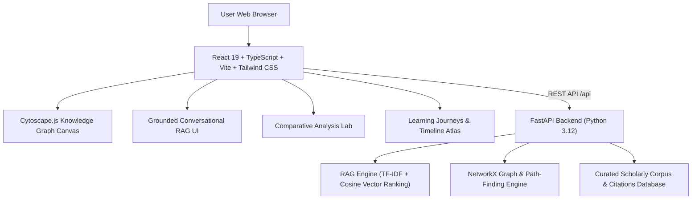

# ANVESHANA (अन्वेषणा)
### *Discover the connections within India's knowledge traditions.*

**AI-Powered Interactive Exploration and Comparative Analysis Platform for Indian Knowledge Systems (IKS)**

---

## 1. Executive Overview

**ANVESHANA** is a full-stack, academically grounded research platform and interactive digital museum designed for students, researchers, and curious minds to explore the intellectual universe of Indian Knowledge Systems (IKS).

Unlike superficial dashboards or static encyclopedias, ANVESHANA integrates three interconnected core systems:

1. **Interactive IKS Knowledge Graph**: An interactive network graph powered by Cytoscape.js with over 50 curated entities (scholars, primary treatises, mathematical principles, pyrotechnologies, and epistemological schools) interconnected by over 60 explicit, sourced relationship edges. Features pathfinding between concepts, degree-based sizing, and neighborhood expansion.
2. **AI-Powered IKS Guide (Grounded RAG Assistant)**: A conversational research assistant using Retrieval-Augmented Generation (RAG) backed by TF-IDF / Cosine Vector ranking across authentic scholarly chunks. Delivers concise syntheses, detailed expositions, historical context, key takeaways, and verifiable primary citations (from texts like *Aryabhatiya*, *Ashtadhyayi*, *Chandaśāstra*, *Brahmasphutasiddhanta*, and peer-reviewed journals like *Nature* and *Current Science*).
3. **Comparative Analysis Lab**: A dedicated epistemic engine that compares traditional IKS breakthroughs with modern scientific counterparts (e.g., Pingala ↔ Binary Radix & Leibniz; Panini ↔ Backus-Naur Form & Chomsky Syntax; Wootz Steel ↔ Carbon Nanotube UHCS Metallurgy; Stepwells ↔ Modern Sponge Cities). Every comparison incorporates a transparent **Evidence-Strength Indicator** and an academic warning against false equivalence.

---

## 2. Visual & Design Identity

- **Palette**: Midnight blue (`#070A12`, `#0B0F19`), Deep indigo (`#1E1B4B`), Charcoal (`#131B2E`), Antique gold (`#D4AF37`, `#E6CA65`), Muted copper (`#C87D55`, `#B85D38`), and Warm ivory (`#FCFAF6`).
- **Typography**: Editorial classical serif headings (*Cinzel*, *Playfair Display*) paired with modern geometric UI sans-serif (*Plus Jakarta Sans*).
- **Manuscript Geometry**: Subtle radial grid backgrounds, astrolabe-inspired rotating logo motifs, layered glassmorphic panels, and smooth micro-interactions.
- **Dark & Light Mode**: Default dark digital-museum theme with seamless light mode toggle.

---

## 3. Architecture & Tech Stack



- **Frontend**: React 19, TypeScript, Vite, Tailwind CSS 3.4, Lucide Icons, Cytoscape.js.
- **Backend**: Python 3.12, FastAPI, Uvicorn, NetworkX, Scikit-Learn, Pydantic v2, HTTPX.
- **Corpus**: Primary Sanskrit editions (*INSA*, *Motilal Banarsidass*, *Harvard Oriental Series*), archaeological excavation memoirs (*Archaeological Survey of India*), and peer-reviewed papers (*Nature*, *Princeton University Press*).

---

## 4. Curated IKS Disciplinary Coverage

### Mathematics & Combinatorics
- **Acharya Pingala & Chandaśāstra (c. 3rd c. BCE)**: Syllable states (Laghu/Guru), binary enumeration (*Prastara*), integer-to-binary mapping (*Nashtam*), index evaluation (*Uddishtam*), and binomial coefficient staircase (*Meru Prastara* / Pascal's triangle precursor).
- **Aryabhata I (499 CE)**: Sine tables (*Jya*), decimal place-value notation, approximation of $\pi \approx 3.1416$, and *Kuttaka* (indeterminate linear equation pulverizer).
- **Brahmagupta (628 CE)**: Formal operational arithmetic of zero (*Shunya*), signed numbers (positive/negative), and cyclic quadrilateral theorem.
- **Madhava of Sangamagrama & Kerala School (c. 1380–1540 CE)**: Infinite power series for sine, cosine, and arctangent (*Madhava-Gregory-Leibniz series*), rational convergence corrections, and Jyeshthadeva's *Yuktibhasha* (world's first calculus proof textbook).
- **Baudhayana Sulba Sutras (c. 800 BCE)**: Early diagonal theorem (Pythagorean theorem) and rational surd approximation $\sqrt{2} \approx 1.4142156$.

### Linguistics & Automata
- **Panini & Ashtadhyayi (c. 5th c. BCE)**: 3,959 context-sensitive generative rewrite rules, 14 *Shiva Sutras* (phonological regular expression matrices), *Karaka* theory (deep case grammar anticipating NLP dependency parsing), and meta-rule conflict resolution (*Paribhashas*).
- **Patanjali's Mahabhashya**: Philosophy of language, semantic signifiers (*Sphota*), and dialectical discourse.

### Astronomy & Cosmology
- **Aryabhata**: Explicit assertion of the daily diurnal axial rotation of the Earth using the optical relativity boat analogy (*Golapada 9*).
- **Nilakantha Somayaji (1501 CE)**: *Tantrasamgraha* geo-heliocentric planetary model where inner and outer planets orbit the Sun, which orbits Earth.
- **Panchanga**: Five-limb lunisolar ephemerides coordinate calculations.

### Metallurgy & Pyrotechnology
- **Wootz Crucible Steel (Ukku)**: High-carbon (1.0–1.9% C) closed-crucible smelting at Kodumanal; Damascus blade spheroidized cementite banding and carbon nanotube structures.
- **Iron Pillar of Delhi (c. 400 CE)**: Phosphorus-catalyzed crystalline misawite passive protective film resisting atmospheric corrosion for 1,600 years.
- **Zawar Industrial Zinc Smelting (c. 8th c. BCE – 18th c. CE)**: Downward retort distillation (*Tiryakpatana Yantra*) overcoming zinc's low boiling point (907°C) centuries before William Champion.

### Hydraulic Architecture & Urban Design
- **Dholavira Harappan Network (c. 2600 BCE)**: 16 cascading stone-cut reservoirs and check-dam sluices harvesting 250,000 m³ of stormwater on an arid island.
- **Subterranean Stepwells (*Vavs* & *Baolis*)**: Rani ki Vav (Patan) multi-tier aquifer recharge, earth-sheltered structure, and 5–10°C passive microclimate cooling.
- **Thar Desert Tankas & Kunds**: Lime-surkhi plastered sealed cisterns providing drought resilience without modern energy inputs.
- **Vastu Purusha Mandala**: Modular fractal spatial geometry for city planning and temple architecture.

### Philosophy & Epistemology (Pramana-Shastra)
- **Four Valid Pramanas (Nyaya)**: *Pratyaksha* (Perception), *Anumana* (Five-member inference integrating induction and deduction), *Upamana* (Analogical mapping), and *Shabda* (Trustworthy authoritative testimony).
- **Vyapti**: Invariable universal concomitance guaranteeing deductive validity.
- **Kanada & Paramanuvada**: Vaisheshika classical atomic physical realism.

---

## 5. Quickstart & Local Execution

### Prerequisites
- Node.js (v18+)
- Python (v3.10+)
- pnpm or npm

### Setup & Run Commands

#### Step 1: Clone / Navigate to Directory
```bash
cd "C:\Users\ZSHREE\.gemini\antigravity\scratch\anveshana"
```

#### Step 2: Run the Unified FastAPI Application
The FastAPI backend serves both the complete REST API (`/api/...`) and the built interactive React frontend from a single server:

```powershell
cd backend
python -m uvicorn main:app --host 127.0.0.1 --port 8000 --reload
```
Open **[http://localhost:8000](http://localhost:8000)** in your browser!

#### Step 3 (Optional): Run Frontend in Vite Hot-Reload Dev Mode
If you wish to edit the frontend code live with instant hot-module-replacement (HMR):
```powershell
cd frontend
pnpm dev
```
Open **[http://localhost:5173](http://localhost:5173)** in your browser! (Vite automatically proxies API requests to `http://localhost:8000`).

---

## 6. Running the Automated Test Suite

A comprehensive test suite verifies API integrity, graph pathfinding, RAG citations, and comparative analysis models:

```powershell
python tests\test_api.py
```

Expected output:
```text
✓ test_stats_endpoint passed
✓ test_entities_endpoint passed
✓ test_entity_detail_and_network passed
✓ test_graph_and_pathfinding passed
✓ test_universal_search passed
✓ test_comparative_analysis passed
✓ test_learning_journeys passed
✓ test_sources_catalog passed
✓ test_rag_assistant_grounding passed
✓ test_bookmarks_persistence passed

=========================================
ALL 10 VERIFICATION TESTS PASSED CLEANLY!
=========================================
```

---

## 7. Project Structure

```text
anveshana/
├── backend/
│   ├── main.py             # FastAPI REST endpoints, CORS, static mount
│   ├── models.py           # Pydantic data schemas (Entities, Graph, Comparisons, RAG)
│   ├── data_seed.py        # Curated scholarly dataset: 51 entities, 63 relations, 18 sources
│   └── rag_engine.py       # TF-IDF + Cosine similarity RAG pipeline & citations
├── frontend/
│   ├── src/
│   │   ├── api/client.ts   # API fetch clients with caching & localStorage sync
│   │   ├── components/
│   │   │   ├── Navbar.tsx             # Brand, nav tabs, search trigger, bookmarks counter
│   │   │   ├── SearchModal.tsx        # Universal Ctrl+K search command palette
│   │   │   ├── EntityDetailModal.tsx  # Dossier with tabs (Context, Network, Sources)
│   │   │   ├── SourceModal.tsx        # Bibliographic citation & excerpt inspector
│   │   │   └── BookmarksDrawer.tsx    # Saved explorations drawer
│   │   ├── pages/
│   │   │   ├── LandingPage.tsx        # Interactive hero canvas, discipline matrix, pillars
│   │   │   ├── GraphPage.tsx          # Cytoscape.js knowledge graph & path-finder
│   │   │   ├── AiGuidePage.tsx        # Conversational RAG assistant with citations
│   │   │   ├── ComparativeLabPage.tsx # Side-by-side comparative matrices & evidence ratings
│   │   │   ├── JourneysPage.tsx       # 5 curated interactive learning journeys
│   │   │   ├── TimelineAtlasPage.tsx  # Chronological timeline & historical geographic map
│   │   │   └── SourcesPage.tsx        # Peer-reviewed & critical edition catalog
│   │   ├── types/index.ts  # TypeScript type definitions
│   │   ├── App.tsx         # Root state orchestration & routing
│   │   ├── index.css       # Midnight blue, gold, and manuscript custom typography
│   │   └── main.tsx        # React entrypoint
│   ├── package.json
│   ├── tailwind.config.js
│   └── vite.config.ts
├── tests/
│   └── test_api.py         # Automated API & verification suite
└── README.md
```

---

## 8. Academic Integrity Statement

> *"True scholarship honors traditional achievements not by exaggerating them with unfounded modern claims, but by documenting their authentic mathematical, empirical, and philosophical depth within their own historical reality."*

ANVESHANA upholds rigorous research ethics:
- Never attributes modern quantum mechanics, digital computers, or aviation to ancient times without evidence.
- Grounds all mathematical claims in critical editions of primary texts (*Aryabhatiya*, *Chandaśāstra*, *Ashtadhyayi*, *Brahmasphutasiddhanta*, *Sulba Sutras*, *Yuktibhasha*).
- Clearly separates:
  1. Established historical facts
  2. Documented algorithmic isomorphisms
  3. Structural analogies
  4. Later scholarly interpretations
